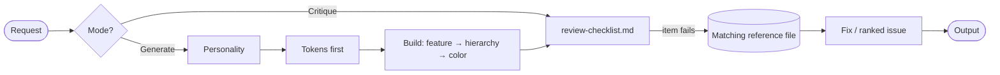

<div align="center">

# 🎨 Refactoring UI · Claude Skill

**Turn Claude into a design-system-obsessed UI designer.**

A [Claude Code](https://claude.com/claude-code) skill that distills all 8 chapters of *Refactoring UI*
into enforceable rules: Claude **generates** polished, token-driven web UI and **critiques**
existing pages with ranked, value-level fixes.


[Why](#-why) · [Install](#-install) · [Usage](#-usage) · [How it works](#-how-it-works) · [The system](#-the-design-system) · [Evals](#-evals--results)

</div>

---

## ✨ Why

Ask an LLM for a pricing page and you get something that *works* but feels off: 26 different
spacing values, 5 font sizes nobody picked on purpose, borders around everything, four equally
loud buttons. This skill turns the book's advice into a checklist Claude applies every time.

<table>
<tr>
<td width="50%" valign="top">

### Without the skill
- 18–26 distinct spacing values per page
- 10–16 **off-scale** spacing values
- 3–5 off-scale font sizes
- 7–12 borders doing all the separation
- Critiques lead with legal/functional nits

</td>
<td width="50%" valign="top">

### With the skill (v0.9 eval run)
- 9–12 spacing values, **all on one scale**
- **0** off-scale spacing values
- **0** off-scale font sizes
- 2–3 borders: shadow + background do the work
- Critiques ranked by visual impact, with exact values

</td>
</tr>
</table>

> Measured with [`evals/metrics.py`](evals/metrics.py) on the same prompts. See [Evals & results](#-evals--results).

---

## 🚀 Install

Clone into your Claude Code skills directory:

```bash
git clone git@github.com:andreaschandra/refactoring-ui.git ~/.claude/skills/refactoring-ui
```

That's it. No dependencies and no build step. The skill is plain Markdown.

---

## 💬 Usage

The skill triggers when you name it or explicitly ask for a visual-design review.

### Mode A: Generate

```text
/refactoring-ui Build a pricing page for a project-management SaaS with three tiers
(Free, Pro, Team), a monthly/annual toggle, and an FAQ section. Single HTML file.
```

Claude will:
1. **State a personality** (audience → typeface, radius, accent, copy tone) as a comment at the top of the file.
2. **Define the system first**: spacing, type, weight, OKLCH palette, 5-level shadows, radius, border and opacity tokens.
3. **Build feature-first**, with hierarchy before color, using only values from the scales.
4. **Self-review** against the full checklist and fix every failure before returning.

### Mode B: Critique

```text
Critique the visual design of team.html.
```

You get issues ranked by impact, each paired with a concrete fix:

```text
[impact: high] The banner subtitle fails contrast: grey #9ca3af on #4f46e5 is ~2.5:1
  → Use a light tint of the banner hue, e.g. oklch(88% 0.06 277), and cap it at max-width: 60ch.

[impact: high] Borders everywhere: card borders, header dividers, row dividers
  → Cards: white on grey-50 with shadow level 1, no border; separate rows with 16px spacing.
```

Then come **the 3 changes that would help most**, and a short **Beyond visual design** section
for blocking accessibility issues (viewport, landmarks, labels, focus styles).

---

## 🧠 How it works



`SKILL.md` is a lean router. Claude loads **only the reference files the task needs**, which keeps context small:

| Concern | Reference |
|---|---|
| ✅ Review checklist (every mode) | [`review-checklist.md`](references/review-checklist.md) |
| 🧭 Starting from scratch: feature-first, personality, value systems | [`process.md`](references/process.md) |
| 🏔️ Hierarchy: weight, color, labels, button hierarchy | [`hierarchy.md`](references/hierarchy.md) |
| 📐 Layout & spacing: scale, widths, grids, grouping | [`layout-spacing.md`](references/layout-spacing.md) |
| 🔤 Typography: type scale, line length, line height, alignment | [`typography.md`](references/typography.md) |
| 🎨 Color: OKLCH, shade scales, tinted greys, contrast | [`color.md`](references/color.md) |
| 🌗 Depth: light source, elevation, two-part shadows | [`depth.md`](references/depth.md) |
| 🖼️ Images: text on photos, icon sizing, user uploads | [`images.md`](references/images.md) |
| 💎 Finishing touches: accent borders, empty states, fewer borders | [`finishing.md`](references/finishing.md) |

### Core principles

| | |
|---|---|
| **Systematize everything** | Every size, space, color, weight, shadow and radius comes from a small predefined scale. |
| **Feature first** | Design what the user came to do before the shell around it. |
| **Hierarchy before color** | The UI must read correctly in grayscale. |
| **No implied features** | Never show a control the page can't back up. |
| **Group with space** | More space around groups than within them. Start generous, then remove. |
| **Fewer borders** | Use spacing, background or a shadow before reaching for a line. |
| **Color supports, never carries** | Meaning survives without color, and contrast meets WCAG AA. |
| **Emphasize by de-emphasizing** | One #1 element and one primary action per view. |

---

## 📏 The design system

The default scales the skill enforces. Anything off-scale is treated as a defect.

| Token | Values |
|---|---|
| **Spacing & sizing** | `4 8 12 16 24 32 48 64 96 128 192 256 384 512 640 768` px (2px micro-step inside small components only) |
| **Font size** | `12 14 16 18 20 24 30 36 48 60 72` px, in `px`/`rem`, never `em` |
| **Font weight** | 2 weights (normal + bold), none below 400 |
| **Color** | OKLCH: 8–10 tinted greys + primary/accent/semantic hues, `100–900` shades, no pure black |
| **Shadow** | 5-level elevation scale, two-part shadows, light from above |
| **Radius** | `0 4 8 12 16 full`, one style per UI |
| **Border width** | `1 2 4` px (4 for accent borders) |
| **Opacity** | `.5` disabled · `.7` scrims · `1`; never used to de-emphasize text |

---

## 🧪 Evals & results

Every chapter shipped with evals. The harness in [`evals/`](evals/) runs **5 fixed tasks**
(2 generate, 3 critique) in fresh Claude Code sessions and compares them against a no-skill baseline.

```bash
python evals/metrics.py evals/runs/<run>/*.html   # resolves var() tokens and rem → px
```

### System discipline (baseline → v0.5.1 → v0.9)

| Output | Spacing values | Off-scale spacing | Off-scale font | Borders |
|---|---|---|---|---|
| `gen-pricing` | 26 → 10 → 12 | 16 → 0 → **0** | 5 → 0 → **0** | 12 → 7 → **3** |
| `gen-settings` | 18 → 11 → 10 | 10 → 0 → **0** | 3 → 0 → **0** | 8 → 6 → **3** |
| `signup-fixed` | 17 → 8 → 9 | 10 → 0 → **0** | 4 → 0 → **0** | 7 → 1 → **2** |

### Critique recall

On `team.html`, a fixture that *looks fine at first glance* with **16 planted issues**
([answer key](evals/ANSWER_KEY.md)):

- **v0.5.1:** 16 / 16 caught
- **v0.9:** 13 full + 2 partial, plus new finds (count mismatch, unlabeled search, ambiguous button names)
- **v1.0:** adds an explicit grouping check for spacing that's on-scale but uniform, the one miss in v0.9

Full write-ups: [v0.5.1 report](evals/runs/v0.5.1/REPORT.md) · [v0.9 report](evals/runs/v0.9/REPORT.md)

---

## 🗂️ Repository layout

```text
refactoring-ui/
├── SKILL.md                 # Entry point: modes, routing table, core principles
├── references/              # One file per book chapter + the review checklist
│   ├── review-checklist.md
│   ├── process.md  hierarchy.md  layout-spacing.md  typography.md
│   └── color.md    depth.md      images.md          finishing.md
└── evals/
    ├── cases.json           # 5 fixed prompts + expected behaviors per chapter
    ├── ANSWER_KEY.md        # Planted issues per fixture (never copied into runs)
    ├── fixtures/            # dashboard.html, signup.html, team.html
    ├── metrics.py           # Counts design-system discipline in HTML output
    └── runs/                # baseline/, v0.5.1/, v0.9/ outputs + reports
```

---

## 🛣️ Changelog highlights

| Version | Milestone |
|---|---|
| **v0.0** | Skill skeleton + eval harness |
| **v0.1–v0.4** | Ch 1–4: process, hierarchy, layout & spacing, typography (with default scales) |
| **v0.5** | Ch 5: color in **OKLCH** (the book's HSL techniques kept as reasoning) |
| **v0.6–v0.8** | Ch 6–8: depth, images, finishing touches; all 8 chapters complete |
| **v0.9** | Consolidation: deduplicated checks, radius/border/opacity defaults, name-triggered activation |
| **v1.0** | Explicit grouping check for uniform on-scale spacing; shadow expectations fixed |

---

<div align="center">

### 🙏 Credits

Based on the ideas in **[Refactoring UI](https://www.refactoringui.com/)** by Adam Wathan & Steve Schoger.<br>
This is an independent, unofficial distillation for Claude, and it is not affiliated with or endorsed by the authors.<br>
Buy the book: it's worth it.

</div>
